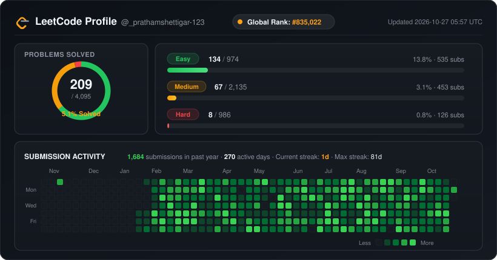

<h1 align="center">Pratham Shettigar</h1>

  

  

  

##  About Me

I build AI systems that survive contact with production: **agents, RAG pipelines, and the evals that keep them honest.**

I'm a Computer Science student who builds full-stack GenAI applications end to end — from the model and vector database to the API and the interface. I focus on making AI systems that keep working beyond the demo: accurate retrieval, proper evaluation, tracing, and reliable deployment.

##  Languages & Tools

##  LeetCode Dashboard

  

##  Activity

  <picture>
    <source media="(prefers-color-scheme: dark)" srcset="https://raw.githubusercontent.com/shettigarpratham6-web/shettigarpratham6-web/output/github-contribution-grid-snake-dark.svg" />
    <source media="(prefers-color-scheme: light)" srcset="https://raw.githubusercontent.com/shettigarpratham6-web/shettigarpratham6-web/output/github-contribution-grid-snake.svg" />
    
  </picture>

##  Connect With Me

